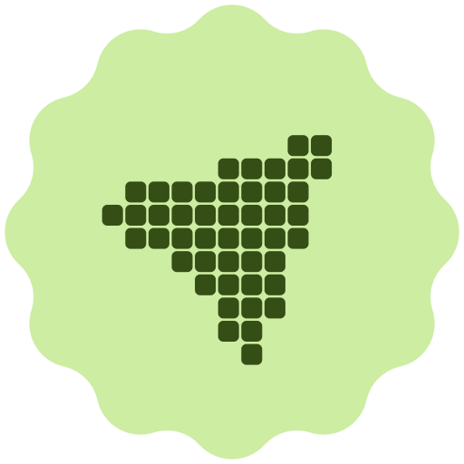
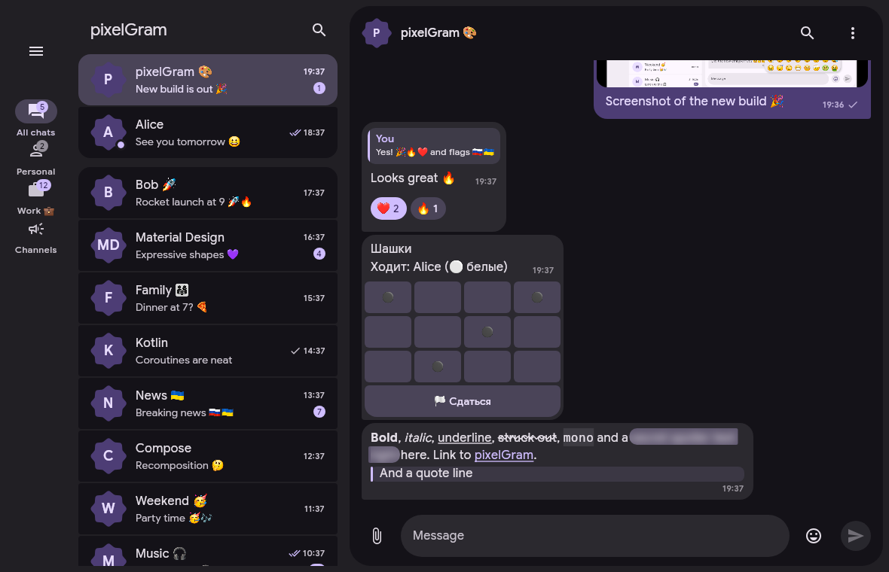
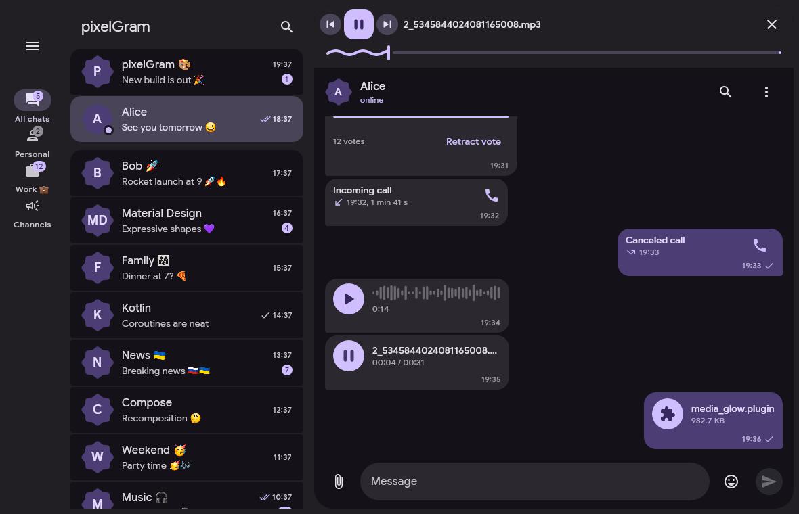
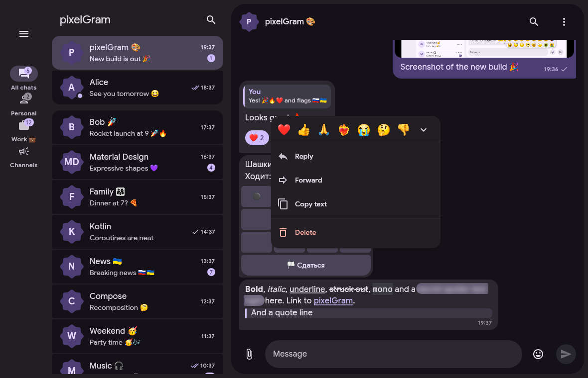
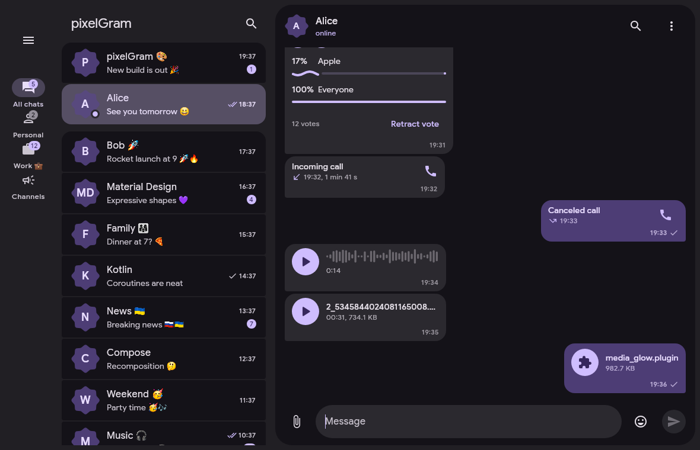
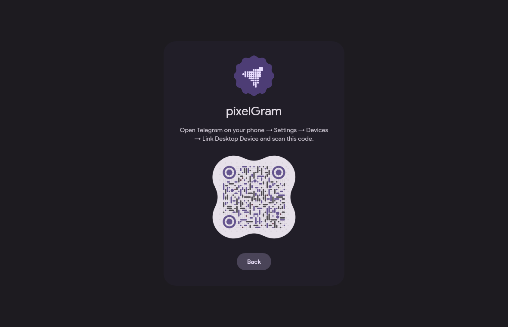
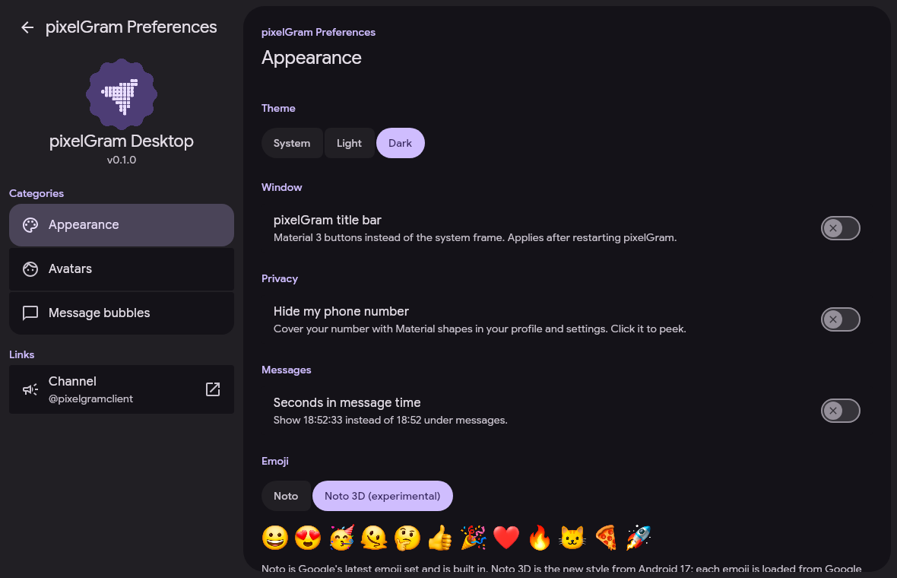
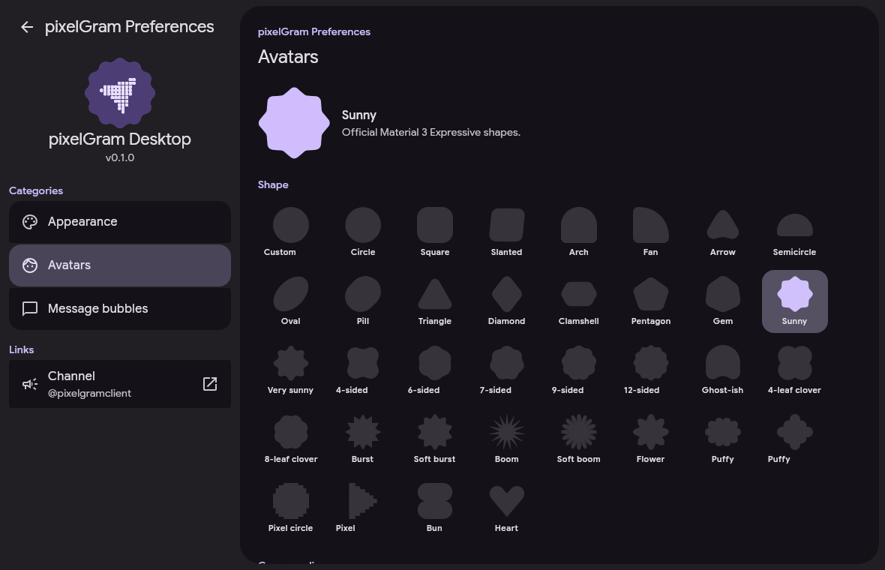
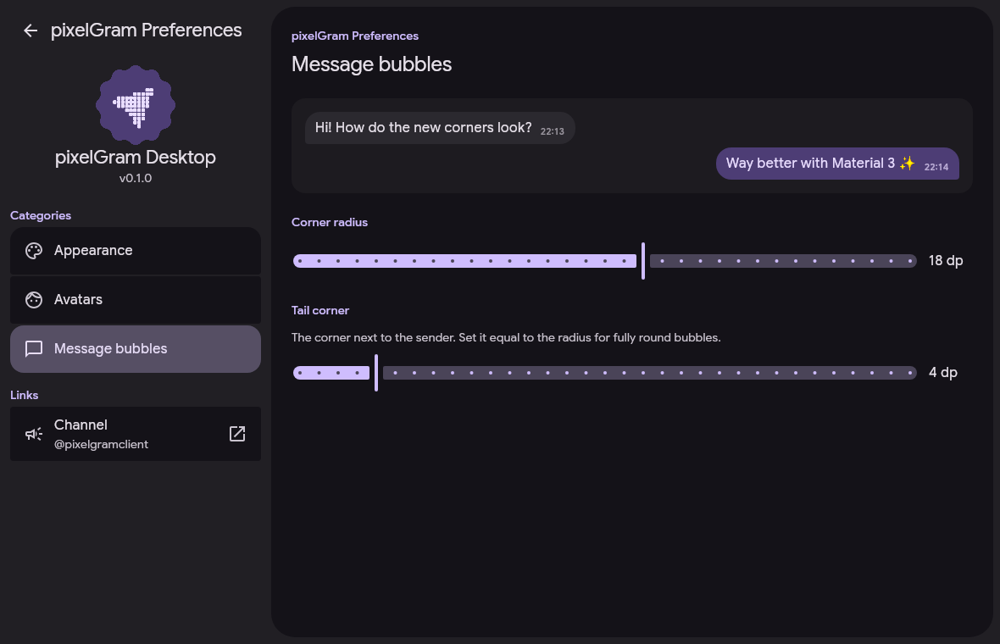

<p align="center">
  
</p>

# pixelGram

Telegram desktop client built with **Kotlin**, **Compose Multiplatform** and
**Material 3 Expressive**, powered by **TDLib** (via TDLight).

Channel: [@pixelgramclient](https://t.me/pixelgramclient)

## Screenshots



| | |
|:-:|:-:|
|  |  |
| Music player with Material 3 morphing controls | Reactions and message actions |
|  |  |
| Polls, calls, voice and files | Sign in with a QR code |
|  |  |
| Appearance settings | Every Material 3 Expressive shape for avatars |
|  | |
| Bubble corners with a live preview | |

## Features

- Material 3 Expressive UI from the official Compose Material 3 library
- Dynamic color schemes generated with Google's material-color-utilities
- Material You from your wallpaper with [matugen](https://github.com/InioX/matugen) (Linux)
- Avatar shapes: all official Material 3 shapes (`MaterialShapes`) and a custom corner radius
- Message bubble corner and tail radius in a separate settings section
- Chat folders in a Material 3 navigation rail or as tabs, optional hidden "All chats"

## Install

- **Arch Linux and derivatives:** `sudo pacman -U pixelgram-*.pkg.tar.zst`
- **Windows:** run the `.msi` installer or unpack the portable `.zip`
- **Any Linux (AppImage):** `chmod +x pixelGram-x86_64.AppImage && ./pixelGram-x86_64.AppImage`
- **Any Linux (archive):** unpack `pixelGram-linux-x86_64.tar.gz` and run `pixelGram/bin/pixelGram`
- **macOS (Apple Silicon):** open `pixelGram-macos-arm64.dmg` and drag pixelGram to Applications
- Sign in by phone, code, two-step password or QR code

## Building

Requirements: JDK 21.

```bash
./gradlew run                    # run from sources
./gradlew createDistributable    # Linux app folder (Arch package: packaging/arch)
./gradlew packageMsi             # Windows .msi
./gradlew packageDmg             # macOS .dmg (Apple Silicon)
./gradlew createDistributable    # portable folder in build/compose/binaries
```

Telegram API credentials (from https://my.telegram.org) can be passed at build
time with `TELEGRAM_API_ID` / `TELEGRAM_API_HASH` environment variables or the
`pixelgram.apiId` / `pixelgram.apiHash` Gradle properties. Without them the app
asks for them on first launch.

On Linux the TDLib native library needs OpenSSL 3 (any current distribution).

### macOS

The macOS build uses the same Compose Multiplatform sources and the same
Material 3 Expressive UI as the Linux and Windows builds. TDLib is shipped as the
official `macos_arm64` native library, so Apple Silicon is required.

The app bundle is ad hoc signed and carries microphone/camera usage strings,
`tg://` URL registration and a notification bridge. Downloaded builds are not
notarized; if Gatekeeper blocks the first launch, open the app from the context
menu or run `xattr -dr com.apple.quarantine /Applications/pixelGram.app`.

Set `CODESIGN_IDENTITY` (or `-Ppixelgram.macSigningIdentity`) to a Developer ID
Application identity to sign a release build instead of using the ad hoc
signature. macOS may withhold notification authorization from ad hoc builds;
pixelGram then falls back to its in-app notification style.

The bundle metadata (usage descriptions, URL scheme, high-DPI flag) is applied
after `jpackage` in `build.gradle.kts`. macOS does not need matugen: dynamic
colors from the system are not part of the design.

## Material You with matugen (Linux)

Enable **Settings → Appearance → Dynamic colors from matugen**, then add to
`~/.config/matugen/config.toml`:

```toml
[templates.pixelgram]
input_path = '~/.config/pixelgram/matugen-template.json'
output_path = '~/.config/pixelgram/matugen.json'
```

Run `matugen image /path/to/wallpaper.png` and pixelGram picks up the colors.

## Data

All data lives in `~/.local/share/pixelgram` (Linux), `%APPDATA%\pixelgram`
(Windows) or `~/Library/Application Support/pixelgram` (macOS).

The previous C++ version (AyuGram Desktop fork) is kept in the `legacy-cpp` branch.

## Credits

- [Mategram](https://github.com/MG-Devs-Team/Mategram): the blurred spoiler effect is based on their formatted text rendering.
- [Material Player](https://github.com/YouRooni/plugins/tree/master/plugins/md3_player) by @RnPlugins: the morphing playback buttons in the mini player follow its controls row.
- [end-4/dots-hyprland](https://github.com/end-4/dots-hyprland): the password field with Material shapes comes from its lock screen.
- [Telegram Desktop](https://github.com/telegramdesktop/tdesktop) (GPLv3): swipe to reply with a touchpad follows its `swipe_handler.cpp`: direction lock, reply on release, damped overswipe and the bounce at the threshold.
- [kitty](https://github.com/kovidgoyal/kitty) by Kovid Goyal (GPLv3): the Kitty trail cursor style is ported from its `cursor_trail.c`.
- [NTgCalls](https://github.com/pytgcalls/ntgcalls) by the PyTgCalls team (LGPL-3.0): voice and video calls and screen sharing. pixelGram downloads its unmodified shared library from the official release on the first call and checks its SHA-256.

## License

GPLv3, see `LICENSE`.
