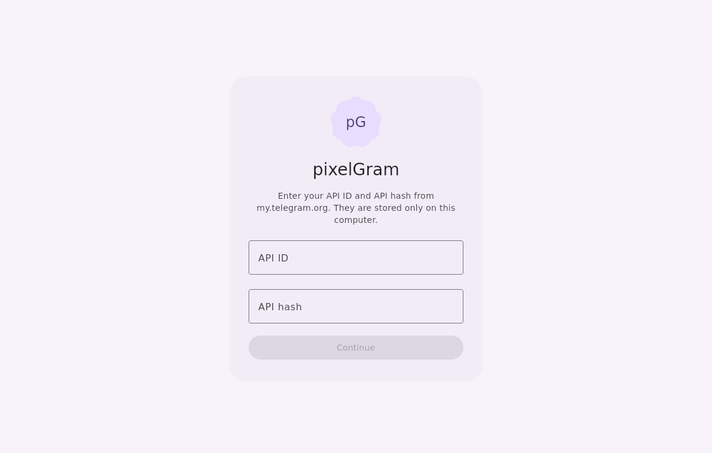

<p align="center">
  
</p>

# pixelGram

Telegram desktop client built with **Kotlin**, **Compose Multiplatform** and
**Material 3 Expressive**, powered by **TDLib** (via TDLight).

Channel: [@pixelgramclient](https://t.me/pixelgramclient)

## Screenshots



## Features

- Material 3 Expressive UI from the official Compose Material 3 library
- Dynamic color schemes generated with Google's material-color-utilities
- Material You from your wallpaper with [matugen](https://github.com/InioX/matugen) (Linux)
- Avatar shapes: all official Material 3 shapes (`MaterialShapes`) and a custom corner radius
- Message bubble corner and tail radius in a separate settings section
- Chat folders in a Material 3 navigation rail or as tabs, optional hidden "All chats"

## Install

- **Arch Linux and derivatives:** `sudo pacman -U pixelgram-*.pkg.tar.zst`
- **Windows:** run the `.msi` installer or unpack the portable `.zip`
- **Any Linux:** unpack `pixelGram-linux-x86_64.tar.gz` and run `pixelGram/bin/pixelGram`
- Sign in by phone, code, two-step password or QR code

## Building

Requirements: JDK 21.

```bash
./gradlew run                    # run from sources
./gradlew createDistributable    # Linux app folder (Arch package: packaging/arch)
./gradlew packageMsi             # Windows .msi
./gradlew createDistributable    # portable folder in build/compose/binaries
```

Telegram API credentials (from https://my.telegram.org) can be passed at build
time with `TELEGRAM_API_ID` / `TELEGRAM_API_HASH` environment variables or the
`pixelgram.apiId` / `pixelgram.apiHash` Gradle properties. Without them the app
asks for them on first launch.

On Linux the TDLib native library needs OpenSSL 3 (any current distribution).

## Material You with matugen (Linux)

Enable **Settings → Appearance → Dynamic colors from matugen**, then add to
`~/.config/matugen/config.toml`:

```toml
[templates.pixelgram]
input_path = '~/.config/pixelgram/matugen-template.json'
output_path = '~/.config/pixelgram/matugen.json'
```

Run `matugen image /path/to/wallpaper.png` and pixelGram picks up the colors.

## Data

All data lives in `~/.local/share/pixelgram` (Linux), `%APPDATA%\pixelgram`
(Windows) or `~/Library/Application Support/pixelgram` (macOS).

The previous C++ version (AyuGram Desktop fork) is kept in the `legacy-cpp` branch.

## License

GPLv3, see `LICENSE`.
